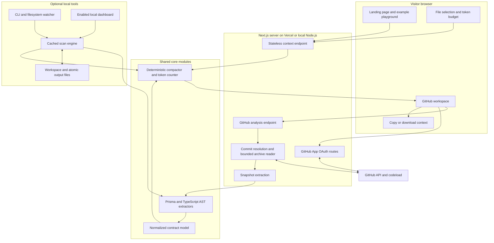
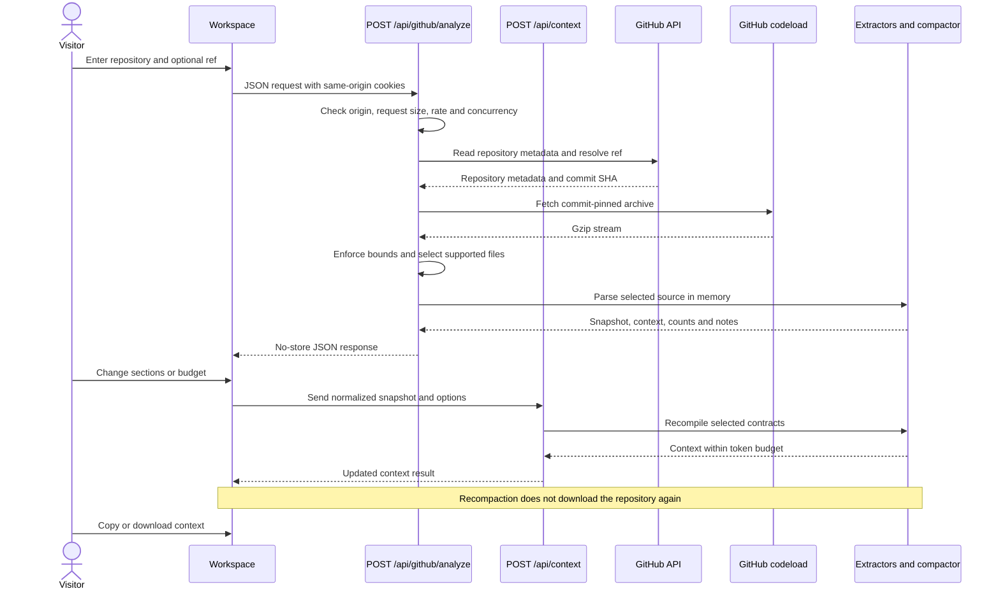
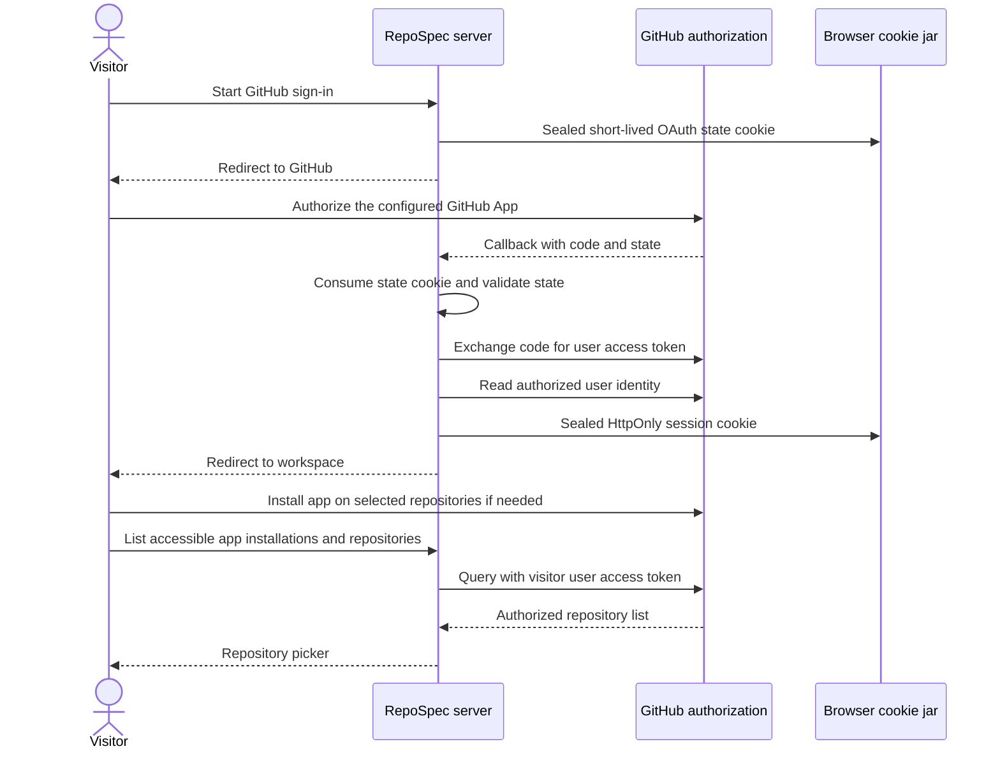
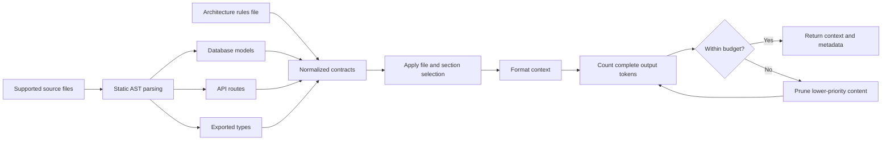
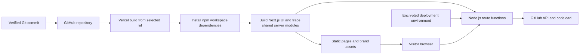
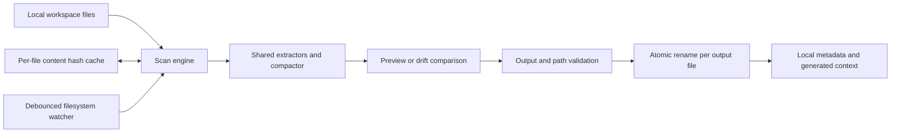

<p align="center"></p>

# RepoSpec

**Give your AI coding assistant the contracts your code actually defines.**

RepoSpec is a Next.js web application that turns a GitHub repository into compact, inspectable context. It extracts database models, API routes, exported TypeScript types, and architecture rules; lets you select what matters; and produces a reference file within a token budget.

Instead of pasting implementation files into every conversation, give your assistant the structure it needs to reason about your project. RepoSpec uses static parsing, not an AI model, to extract supported contracts. It does not guarantee correct AI output: review and test the changes your assistant proposes.

[Website](https://repospec.vercel.app) · [Getting started](#getting-started) · [Architecture](#system-architecture) · [GitHub access](#github-app-setup) · [Deployment](#deploying-to-vercel) · [CLI](#companion-cli) · [Limitations](#limitations-and-production-considerations)

## Contents

- [The problem and the solution](#the-problem-and-the-solution)
- [What you can do](#what-you-can-do)
- [Operating modes](#operating-modes)
- [Technology stack](#technology-stack)
- [Getting started](#getting-started)
- [Using the web application](#using-the-web-application)
- [System architecture](#system-architecture)
- [GitHub analysis flow](#github-analysis-flow)
- [Private repository authorization](#private-repository-authorization)
- [Extraction and token budgeting](#extraction-and-token-budgeting)
- [API reference](#api-reference)
- [Security and data handling](#security-and-data-handling)
- [GitHub App setup](#github-app-setup)
- [Deploying to Vercel](#deploying-to-vercel)
- [Local dashboard](#local-dashboard)
- [Companion CLI](#companion-cli)
- [Local configuration](#local-configuration)
- [Repository layout](#repository-layout)
- [Development and verification](#development-and-verification)
- [Limitations and production considerations](#limitations-and-production-considerations)
- [Troubleshooting](#troubleshooting)
- [Contributing and license](#contributing-and-license)

## The problem and the solution

A coding assistant can propose a plausible field, route, or type that your project never defined. Manually collecting source context also becomes repetitive, consumes the context window, and goes stale after code changes.

RepoSpec addresses this by extracting supported contracts from a specific GitHub commit. You inspect those contracts, include or exclude files and sections, and choose a token budget. The result is portable text you can review before supplying it to an assistant.

For example, a model defining `Project.ownerId` gives the assistant an explicit field reference instead of leaving it to guess `Project.owner`. This is a grounding aid, not a correctness guarantee.

## What you can do

- Analyze a public GitHub repository without signing in, subject to GitHub and application limits.
- Connect selected private repositories through GitHub sign-in and a configured GitHub App.
- Analyze the default branch or supply a branch, tag, or commit. The server resolves it to a commit SHA before downloading.
- Inspect extracted contracts, source-file costs, section counts, warnings, and a token-weighted treemap.
- Toggle source files or contract sections and recompute context without downloading the repository again.
- Set a hosted token budget between 100 and 20,000 tokens.
- Copy the generated text or download `.ai-context.md`, `.cursorrules`, or `CLAUDE.md`.
- Explore a labeled example fixture on the landing page, including actual parser output and token recomputation.
- Use the optional local dashboard and CLI for filesystem scanning, writing context files, and continuous watching.

The hosted app does not push commits, open pull requests, modify repositories, or automatically connect generated files to a coding assistant. Export filenames are workflow options, not integration guarantees.

## Operating modes

| Mode | Input | Processing location | Output | Availability |
| --- | --- | --- | --- | --- |
| Hosted workspace `/app` | Public or authorized private GitHub repository | Next.js server memory | Browser preview, copy, download | Public analysis needs no GitHub App credentials; private analysis needs setup |
| Landing playground `/` | Bundled example fixture | Server parser and context endpoint | Example preview and download | Clearly labeled example data |
| Optional dashboard `/local` | Operator-selected local directory | Local Node.js process | Local preview and context-file writes | Disabled unless explicitly enabled |
| Companion CLI | Local workspace | Local Node.js process | Files, diagnostics, watch updates | Built from this checkout; npm package is not published |

**No Neon database or other application database is integrated or required.** The hosted implementation is stateless between requests apart from encrypted browser cookies and temporary per-instance request counters. Source code is not stored in an application database.

## Technology stack

| Layer | Implementation |
| --- | --- |
| Web framework | Next.js App Router with React and TypeScript |
| Interface | Tailwind CSS, custom CSS, Geist typography, Radix icons |
| Motion | Framer Motion, CSS animation, device reduced-motion support, page-wide pause control |
| TypeScript parsing | `ts-morph` |
| Prisma parsing | `@mrleebo/prisma-ast` |
| Validation | Zod |
| Token counting | `gpt-tokenizer`, o200k encoding |
| Archive handling | `tar-stream`, Node.js streams and gzip |
| Local CLI and watching | Commander, Chokidar, Tinyglobby |
| Sessions | Node.js crypto, AES-256-GCM sealed cookies |
| Testing and packaging | Vitest, TypeScript, tsup, isolated package smoke script |
| CI | GitHub Actions on Ubuntu and Windows with Node.js 22 |
| Hosting target | Vercel, Node.js runtime |

## Getting started

Use Node.js 22 or newer and npm. Node.js 22 is the CI baseline.

```sh
git clone https://github.com/adeyanjufuhad/RepoSpec.git
cd RepoSpec
npm ci
npm run dev
```

Access to the GitHub repository is required if the source repository is private. Open [http://127.0.0.1:3000](http://127.0.0.1:3000) for the landing page and `/app` for the GitHub workspace.

Public repository analysis works without environment credentials, subject to unauthenticated GitHub limits. For GitHub sign-in, copy `ui/.env.example` to `ui/.env.local` and configure the variables described below. Never commit the resulting secret file.

```sh
npm run build
npm start
```

These scripts build and start the Next.js UI. The local launcher binds to `127.0.0.1` and disables Next.js telemetry. Vercel supplies its own hosted runtime.

## Using the web application

1. Open the workspace and enter `owner/repository` or an HTTPS `github.com` repository URL.
2. Optionally enter a branch, tag, or commit. Leave it blank to use the default branch.
3. For a private repository, sign in with GitHub and install the app on the selected repository first.
4. Select **Analyze repository**. Review the resolved commit, extracted counts, and parse/import notes.
5. Inspect the treemap or file list. Include or exclude files and sections, then adjust the token budget.
6. Review the generated context, copy it, or download your chosen filename.
7. Reanalyze after relevant code changes and replace your old context reference.

An analysis is a snapshot. The hosted application does not watch your repository, subscribe to repository webhooks, or silently refresh downloaded context files. Browser analysis state is not a durable project history.

## System architecture

The web and local modes share extraction and compaction modules but have separate ingestion and output boundaries.



The browser receives extracted contracts and generated context, not an archive or a copy of all implementation files. Budget changes send the normalized snapshot back to `/api/context`; that endpoint validates it and recomputes the result.

## GitHub analysis flow



## Private repository authorization

Private access uses a GitHub App user access token. Access is constrained by the visitor's repository access and the app's installation permissions. The website operator's personal GitHub token is not used as a shared visitor credential.



Session lifetime is at most eight hours and never exceeds the token lifetime returned by GitHub. Expired sessions require signing in again; automatic token refresh is not implemented. OAuth state expires after ten minutes and is consumed on callback.

## Extraction and token budgeting



Pruning removes architecture rules first, then types, then routes. Database columns are reduced last, preserving keys where possible. Very small budgets can produce empty context rather than exceed the cap. The token count uses the complete formatted output; per-file costs and treemap areas describe contracts before pruning and exclude some formatting overhead.

The hosted workspace allows 100–20,000 tokens. Local configuration supports values up to 1,000,000; zero or negative values mean unlimited. These limits are deliberately different.

| Source | Supported extraction | Important limits |
| --- | --- | --- |
| Prisma | Models/views, fields, enums, nullability, keys, explicit relations | Static schema definitions |
| Drizzle | Literal PostgreSQL/MySQL/SQLite table declarations, aliases, constraints, direct same-file references | No dynamic factories or cross-file relation inference |
| Zod | Exported literal objects and common primitive, nested, array, union and enum shapes | Composed or transformed patterns may be skipped with notes |
| Next.js App Router | GET, POST, PUT, PATCH, DELETE; groups, dynamic params, aliases and explicit type annotations | No runtime execution or complete inferred response analysis |
| TypeScript | Exported interfaces, type aliases and enums | No whole-program expansion of imported types |
| Rules | Lines in `.repospec/rules.md` | Treated as context data, not executable instructions |

## API reference

All paths are relative to the deployed application. JSON endpoints validate their input. POST endpoints require a browser origin matching the request host; they are not an unrestricted cross-origin public API.

| Method | Endpoint | Purpose |
| --- | --- | --- |
| GET | `/api/auth/session` | Return configuration status, public user identity and installation URL; never return the token |
| GET | `/api/auth/github` | Begin GitHub App user authorization |
| GET | `/api/auth/github/callback` | Validate state and finish authorization |
| POST | `/api/auth/logout` | Clear the session cookie |
| GET | `/api/github/repositories` | List repositories accessible through the visitor's app installations |
| POST | `/api/github/analyze` | Fetch a GitHub snapshot, extract contracts and produce initial context |
| POST | `/api/context` | Recompile a validated extracted snapshot with new options |
| GET | `/api/scan` | Optional local dashboard scan; disabled by default |
| POST | `/api/sync` | Optional local output write; disabled by default |

Analysis request:

```json
{
  "repository": "owner/repository",
  "ref": "main"
}
```

`ref` is optional. The response contains `repository` metadata including the resolved commit, a normalized `snapshot`, compiled `result`, `importWarnings`, and measured `durationMs`. Metrics displayed for an analysis come from that result, not marketing fixtures.

Recompilation request:

```json
{
  "snapshot": { "files": [], "rules": [] },
  "options": {
    "budget": 2500,
    "disabledFiles": [],
    "disabledSections": []
  }
}
```

The empty snapshot above illustrates the request envelope, not a useful repository result. Valid sections are `database`, `routes`, `types`, and `rules`. The endpoint does not fetch repository files or execute code.

## Security and data handling

### Hosted boundaries

- Repository identifiers are restricted to GitHub. Archive downloads use fixed GitHub hosts and validated codeload redirects.
- Supported archive entries are read through bounded streams. The archive is not extracted to the server filesystem.
- Environment files, recognized credentials/key paths, generated directories, unsupported file types, symlinks, and traversal paths are excluded.
- Parsing is static. Analyzed project code, build scripts, and dependencies are never executed or installed.
- Source exists in server memory for request processing; it is not retained in an application database.
- Extracted signatures and rules are returned to the browser and can themselves contain sensitive information. Review exports before sharing them.
- Secret-path exclusion is not comprehensive content-based secret scanning. A secret hard-coded in an otherwise supported declaration may still require manual review.
- GitHub access tokens are encrypted and authenticated in HttpOnly cookies. Secure cookies are used for HTTPS deployments; token values are not returned through session JSON.
- Provider infrastructure can retain operational request metadata according to its own settings. “No application source database” does not mean that all hosting logs are disabled.
- The local filesystem dashboard and write APIs are disabled unless `REPOSPEC_LOCAL_ENABLED=true`. Keep that setting false on hosted deployments.

### Hosted resource limits

| Resource | Current limit |
| --- | --- |
| Compressed archive | 12 MiB |
| Expanded archive | 48 MiB |
| Selected source files | 300 |
| Individual source file | 128 KiB |
| Total selected source bytes | 4 MiB |
| Analysis request JSON | 4 KiB |
| Context request JSON | 2 MiB |
| Analysis response JSON | 2 MiB |
| GitHub JSON request timeout | 15 seconds |
| Archive fetch/stream timeout | 30 seconds per bounded operation |
| Analysis function maximum duration | 60 seconds, subject to hosting configuration |
| Concurrent analyses | 2 per running application instance |
| Analysis requests | 8 per 10-minute IP window per instance |

The in-memory counters are not a distributed quota system. They reset with the process and do not coordinate across Vercel instances. GitHub's own limits apply separately.

## GitHub App setup

Private access is implemented but requires a real GitHub App registration and deployment environment credentials. Do not treat a successful build as verification of private authorization.

1. Register a GitHub App under the account or organization that will operate RepoSpec.
2. Set its homepage to your deployed site and its user authorization callback to `https://YOUR-DOMAIN/api/auth/github/callback`.
3. Grant repository **Contents: Read-only** and the required metadata access. RepoSpec needs no repository write permission or account email scope.
4. Permit installation by the intended audience. For a public product, the registration must allow the appropriate users to install it.
5. Repository webhooks are not used by this implementation; do not enable webhook subscriptions solely for RepoSpec.
6. Configure the App client ID, client secret, app slug, canonical application URL, and a strong session encryption secret in the deployment environment.
7. Redeploy, sign in, install on a selected test repository, and verify that accessible and inaccessible private repositories behave correctly.

See GitHub's [callback URL documentation](https://docs.github.com/en/apps/creating-github-apps/registering-a-github-app/about-the-user-authorization-callback-url) and [registration permission settings](https://docs.github.com/en/apps/maintaining-github-apps/modifying-a-github-app-registration).

| Variable | Purpose | Secret? |
| --- | --- | --- |
| `APP_URL` | Canonical site origin used in OAuth redirects | No |
| `GITHUB_CLIENT_ID` | Registered GitHub App client ID | No |
| `GITHUB_CLIENT_SECRET` | App client secret for code exchange | Yes |
| `GITHUB_APP_SLUG` | Slug used in the app installation URL | No |
| `SESSION_SECRET` | At least 32 characters; protects sealed state/session cookies | Yes |
| `REPOSPEC_LOCAL_ENABLED` | Optional local filesystem mode; false on Vercel | No |
| `REPOSPEC_CWD` | Optional local target directory | Local mode only |

Generate a session secret locally and place it directly in your secret configuration:

```sh
node -e "console.log(require('crypto').randomBytes(32).toString('hex'))"
```

Never put secrets in a `NEXT_PUBLIC_*` variable, source code, the README, a screenshot, or a committed environment file. Use separate registrations or callback settings for development and hosted environments as appropriate. Rotating `SESSION_SECRET` invalidates existing cookies.

## Deploying to Vercel

The repository is an npm workspace. The Next.js application is in `ui/` and imports shared modules from `src/` at the repository root.

| Vercel setting | Value |
| --- | --- |
| Framework preset | Next.js |
| Root directory | `ui` |
| Include source files outside root directory | Enabled |
| Install command | `cd .. && npm ci` |
| Build command | `npm run build` |
| Output directory | Framework default |
| Node.js | 22.x |
| Local filesystem mode | `REPOSPEC_LOCAL_ENABLED=false` |

`next.config.ts` sets both the Turbopack root and output-file tracing root to the repository root. This allows shared parser modules and their runtime dependencies to be included. Vercel documents the root-directory requirement in its [monorepo FAQ](https://vercel.com/docs/monorepos/monorepo-faq).



A preview deployment can validate the public site before production promotion. GitHub sign-in additionally requires `APP_URL` and the App callback to match the environment being tested. Deploying without App credentials leaves private sign-in in its explicit setup-required state; public repository analysis and the example playground do not depend on those credentials.

After deployment, inspect build logs, confirm the deployed commit, and exercise the public analysis flow. Before broader public traffic, assess distributed rate limiting, GitHub unauthenticated quotas, and hosting limits.

## Local dashboard

The legacy filesystem dashboard is optional and separate from the public GitHub product. Enable it only on a machine where you intend to allow local reads and writes:

```powershell
$env:REPOSPEC_LOCAL_ENABLED = 'true'
$env:REPOSPEC_CWD = 'C:\path\to\your-project'
npm run dev
```

```sh
REPOSPEC_LOCAL_ENABLED=true REPOSPEC_CWD=/path/to/project npm run dev
```

Open `/local`. The dashboard scans the chosen directory, previews context, and writes selected outputs when you choose Sync. It refreshes from disk while visible. Do not enable this mode on a shared or public deployment. The local API uses its own session checks and shared core engine.

## Companion CLI

The npm package is not published. Build and run the CLI from the checkout:

```sh
npm run build:cli
node dist/cli.js init --cwd /path/to/project
node dist/cli.js generate --cwd /path/to/project
node dist/cli.js watch --cwd /path/to/project
node dist/cli.js doctor --cwd /path/to/project
```

| Command | Behavior |
| --- | --- |
| `init` | Create configuration without overwriting an existing file |
| `generate` | Scan, compact and write configured context files |
| `watch` | Refresh outputs on supported source changes and deletions |
| `doctor` | Report missing/stale/current output; exit 1 for drift |

Common flags: `--cwd`, `--config`, `--budget`, `--dry-run`, `--verbose`. `init --hook` optionally installs a fail-open post-commit hook while preserving existing hooks. The hook requires an installed `repospec` executable and never downloads packages.

For a local installation from a tarball:

```sh
npm pack
npm install -g ./adeyanjufuhad-repospec-0.1.0.tgz
repospec generate --cwd /path/to/project
```

The package contains the core engine and CLI, not a pre-hosted web application.

## Local configuration

The CLI/local engine reads `.repospec.json`, or a `repospec` object in the target `package.json`, and falls back to defaults with a notice. These settings do **not** configure the hosted GitHub archive ingestion path.

```json
{
  "tokenBudget": 2500,
  "output": [".cursorrules", ".ai-context.md"],
  "include": ["prisma/**/*.prisma", "src/**/*.ts", "app/api/**/*.ts"],
  "exclude": ["**/*.test.ts", "**/node_modules/**"],
  "rulesFile": ".repospec/rules.md",
  "xmlTags": false,
  "disabledFiles": [],
  "disabledSections": []
}
```

Use per-package globs for monorepos, such as `packages/*/src/**/*.ts`. Omitted `--cwd` permits workspace auto-detection; explicit `--cwd` fixes the target. Include/exclude/output paths must stay inside that workspace. The local engine has separate file bounds: source files over 1 MiB and rules over 128 KiB are skipped.



Generated content is deterministic. Local timestamps and generation metadata live in `.repospec/state.json` rather than creating timestamp-only output drift. Existing nonempty files without the RepoSpec header are protected. Writes are atomic per output file; multiple outputs are preflighted together but are not one filesystem transaction.

## Repository layout

```text
RepoSpec/
├── src/
│   ├── cli.ts                 # CLI commands
│   ├── config.ts              # Local config and workspace path validation
│   ├── engine.ts              # Cached local scanning and output sync
│   ├── github.ts              # GitHub metadata and bounded archive ingestion
│   ├── snapshot.ts            # Hosted snapshot extraction and recompaction
│   ├── session.ts             # Sealed sessions and request-origin validation
│   ├── compactor.ts           # Formatting, token counting and pruning
│   ├── model.ts               # Shared contract model
│   ├── watcher.ts             # Local incremental refresh
│   └── extractors/            # AST, schema, route and type extraction
├── ui/
│   ├── app/                   # Landing, workspace, docs, privacy and API routes
│   ├── components/            # Public interface, motion and local dashboard
│   ├── lib/                   # Server auth, request limits and example fixture
│   ├── public/brand/          # Original SVG monogram
│   ├── .env.example           # Placeholder environment names only
│   └── next.config.ts         # Workspace build and runtime dependency settings
├── tests/                     # Core, CLI, watcher and hosted-boundary checks
├── scripts/                   # Dashboard launcher and package smoke verification
├── docs/                      # Implementation, validation and hosted architecture
├── .github/workflows/ci.yml   # Ubuntu and Windows verification
├── DESIGN.md                  # Palette, accessibility and visual decisions
└── README.md
```

## Development and verification

```sh
npm run typecheck
npm test
npm run build
npm run test:package
```

`npm test` first builds the CLI. Tests cover extractor fixtures, golden output, token boundaries, cache reuse, CLI drift, watcher updates/deletions, archive filtering, repository identifiers, encrypted sessions, expiration/tampering, and request origins. The package smoke script installs a packed tarball in an isolated consumer directory and checks the CLI. GitHub Actions runs the verification commands on Ubuntu and Windows.

A passing build verifies compilation and route generation. It does not prove that GitHub App permissions or production OAuth credentials are configured correctly. Validate private authorization with real credentials and appropriately selected test repositories.

The landing page uses original SVG branding, the navy-to-cyan palette in [DESIGN.md](DESIGN.md), Geist fonts, keyboard-accessible controls, motion pausing and reduced-motion preferences. Some motion patterns were researched on 21st.dev; no locked component implementation was copied.

## Limitations and production considerations

- Only GitHub repository ingestion is offered by the hosted product. GitLab, Bitbucket, arbitrary archive URLs, and uploads are not supported.
- SQL migrations, Express, FastAPI, runtime schema factories, full-program type inference and unsupported schema composition are outside current extraction coverage.
- Large repositories may be rejected or contain skipped-file notes. The limits are not a claim of unlimited repository support.
- The repository picker currently reads up to ten installations and the first hundred repositories per installation, with a notice when additional results may exist. Full pagination is not implemented.
- There is no application database, saved scan history, multi-user workspace persistence, billing, AI generation backend, or webhook-driven rescan service.
- GitHub access is read-only. The hosted app does not create files inside repositories.
- Automatic token refresh, distributed request quotas and fleet-wide concurrency limits are not implemented.
- Unauthenticated public GitHub API requests share provider-side infrastructure limits. A busy public deployment may need additional GitHub authentication and distributed abuse controls.
- No promise is made that a generated context file prevents every incorrect assistant response.

## Troubleshooting

| Symptom | What to check |
| --- | --- |
| GitHub sign-in says setup is required | Configure all five auth variables and redeploy |
| OAuth returns to the wrong domain | Match `APP_URL`, the GitHub App callback and the browser environment |
| Private repository is missing | Check visitor access, selected App installation repos, permissions and picker pagination limits |
| GitHub limits the request | Wait, sign in if configured, or inspect provider quotas |
| Archive exceeds bounds | Choose a smaller repository; hosted source limits are intentional |
| Empty or sparse context | Review supported patterns, selected sections/files, token budget and parse notes |
| Cross-site request rejected | Use the app from its actual host and send POST requests with the matching browser origin |
| Local dashboard unavailable | Enable it explicitly for local use; keep it disabled on Vercel |
| Local output is protected | Choose another output path or explicitly manage the existing hand-written file yourself |
| Vercel cannot find shared modules | Use `ui` as root, include outside source files, install from the workspace root and retain tracing configuration |
| A downloaded file appears stale | Reanalyze the desired commit and download a fresh snapshot |

## Contributing and license

Keep changes focused, run relevant verification, and describe behavioral changes and limitations accurately. Add meaningful regression coverage for parser or security-boundary changes. Do not commit credentials, downloaded private source, local generated context, or temporary deployment metadata.

Further documentation: [hosted architecture](docs/HOSTED-ARCHITECTURE.md), [implementation map](docs/IMPLEMENTATION.md), [validation notes](docs/VALIDATION.md), and [design system](DESIGN.md). The implementation map and earlier validation notes describe the original local milestone; this README and the hosted architecture document describe the expanded GitHub web product.

RepoSpec is MIT licensed. See [LICENSE](LICENSE). The vendored React Bits Waves
background has its own MIT + Commons Clause license; see
[third-party notices](THIRD_PARTY_NOTICES.md).
